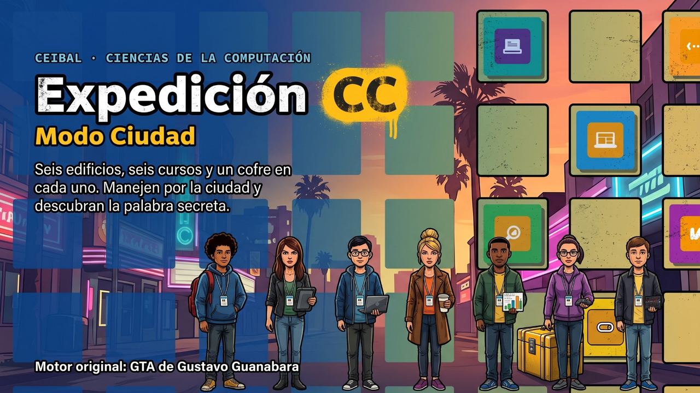

<p align="center">
  
</p>

<h1 align="center">Expedición CC · Modo Ciudad</h1>

<p align="center">
  <strong>Recurso educativo de Ceibal · Programa Ciencias de la Computación.<br>
  Manejen por una ciudad vista desde arriba, visiten seis edificios (uno por curso), resuelvan los laboratorios y junten las letras de la palabra secreta.</strong>
</p>

<p align="center">
  
</p>

---

## Qué es

Es la versión "ciudad" de **Expedición CC**: el mapa de islas se convirtió en una ciudad de mundo abierto. Cada isla es ahora un edificio con techo del color de su curso:

| # | Edificio | Curso | Tutor/a | Laboratorio | Letra |
|---|---|---|---|---|---|
| 1 | Puerto de partida | Fase 1 · Intro a las CC e IA desde cero | Rosario | Mesa de inscripciones, ruta del programa, detector de rumores | U |
| 2 | Isla Web | Desarrollo web | Nacho | Mini editor HTML/CSS/JS, reparar la página, viaje de un paquete | R |
| 3 | Volcán Python | Programación 1, 2 y 3 | Martina | Comillas, bucle, ¿quién es el bucle?, lógica | F |
| 4 | Mina de Datos | Datos para la acción | Joaquín | Consola hacker (SQL), tablas relacionadas | O |
| 5 | Torre IA | IA desde cero · Profundización en IA | Camila | Anti-cheat con umbral, filtro antispam | T |
| 6 | Taller Micro:bit | Micro:bit | Facundo | Sensor de inclinación, eventos | U |
| 7 | Centro Ceibal | Cierre | Rosario | Palabra secreta y ruta de cursos | — |

En cada edificio:
1. El tutor o la tutora presenta el curso.
2. El equipo abre el **laboratorio** (se abre dentro del juego) y resuelve los desafíos.
3. Al terminar, el laboratorio muestra un **código de desbloqueo**. El equipo lo elige en el diálogo. Si se equivoca, recibe una pista y vuelve a intentar.
4. Recibe un **cofre** con una letra (queda en el inventario).

Además hay una **mesa de inscripciones** (techo verde agua, cerca del inicio) con la información del programa, y 12 objetos coleccionables escondidos por la ciudad.

## Guía docente (10–15 minutos)

1. **Minuto 0–2.** Formen equipos de 3:
   - **Piloto:** maneja el celular o la compu.
   - **Escriba:** completa la [bitácora](./docs/bitacora.html) (imprimir una por equipo).
   - **Navegante:** lee el mapa (tecla `M`) y decide.

   Que el piloto pruebe los controles un minuto antes de arrancar.
2. **Minuto 2–12.** Expedición: sigan la flecha amarilla hasta cada edificio. En los laboratorios, anoten la predicción en la bitácora antes de probar.
3. **Minuto 12–15.** Cierre: cada equipo dice su palabra secreta, cuántas islas completó y qué curso le interesó más.

Si un equipo no llega a todos los edificios, igual participa del cierre con las letras que juntó. Con poco tiempo, se puede jugar en dos clases: el progreso queda guardado en el navegador.

**Controles:**
- **Teclado:** flechas o `WASD` para moverse, `Espacio` para acción o acelerar, `Shift`/`X` para frenar, `I` para el inventario, `M` para el mapa, `Esc` para pausa.
- **Celular:** analógico virtual a pie y volante al manejar.
- **Gamepad:** también funciona.

## Cómo editar el contenido

Todo el contenido está en [`story/`](./story), en Markdown, sin tocar el motor:

```text
story/
├── story.md            # título, personajes, ítems y orden de las misiones
├── missions/           # una misión por edificio (01-puerto.md … 07-cierre.md) y el encuentro extra
├── puzzles/            # laboratorios HTML que se abren dentro del juego
├── characters/         # fichas y retratos de tutores y del equipo
├── items/              # cofres (letras) y coleccionables
├── logos-cursos/       # íconos de los cursos (techos de los edificios)
├── map/map.md          # nombres de calles, plazas, comercios y casas
├── npc-lines.md        # frases de la gente en la calle
└── wrong-item-lines.md # reacciones al entregar un ítem equivocado
```

En los diálogos de las misiones se pueden usar estas instrucciones:

```text
- Personaje: Texto que dice.
- LINK: Abrir laboratorio -> puzzles/web.html      (página local o https://...)
- OPCION: Respuesta correcta -> CORRECTO: explicación que se muestra
- OPCION: Respuesta incorrecta -> REINTENTAR: pista; deja volver a intentar
- OPCION: Volver a abrir el laboratorio -> ATRAS
- OPCION: Seguir -> SIGUIENTE
```

### Diálogos en video

Los diálogos se ven como videos animados: título de misión, personajes que entran, quien habla resaltado, texto que se escribe solo y cofre con la letra. Los hace el proyecto [Remotion](https://www.remotion.dev) de la carpeta [`video/`](./video), a partir del mismo Markdown.

En las misiones, `- VIDEO: videos/<id>.mp4` reemplaza a las falas simples que lo siguen. Las falas con opciones o con `LINK` siguen siendo interactivas en el juego. Si un video no carga, el juego muestra esas falas como diálogo común.

Después de cambiar un texto:

```bash
cd video
npm install
npm run sync         # marca los bloques de video en story/missions y prepara los datos
npm run render:all   # genera story/videos/*.mp4 (o: npm run render:all -- 03-volcan)
npm run dev          # opcional: Remotion Studio para previsualizar
```

En el encabezado de cada misión:
- `reward_item:` entrega un ítem al completar la misión.
- `roof_color:` y `roof_logo:` pintan el techo del edificio de destino.

Las palabras clave originales en portugués (`OPCAO`, `NEXT`, `COMPLETE`, `GAMEOVER`) siguen funcionando.

## Ejecutar localmente y tests

El juego usa ES Modules, así que hay que servirlo por HTTP; no funciona abriendo el archivo directamente:

```bash
python3 -m http.server 8080
```

Después, abran `http://localhost:8080`. Para correr los tests:

```bash
node --test tests/*.test.js
```

Para publicarlo en GitHub Pages: **Settings → Pages → Deploy from a branch → `main` / root**.

## Créditos

- **Contenido educativo:** Expedición CC, Ceibal · Programa Ciencias de la Computación.
- **Motor del juego:** [GTA — Guanabara Testando Agentes](https://github.com/gustavoguanabara/gta), de **Gustavo Guanabara** ([Curso em Vídeo](https://www.youtube.com/cursoemvideo)). Este repositorio es un fork adaptado para uso educativo. El repositorio original no declara una licencia; para distribuirlo más allá del aula, consulten al autor.
